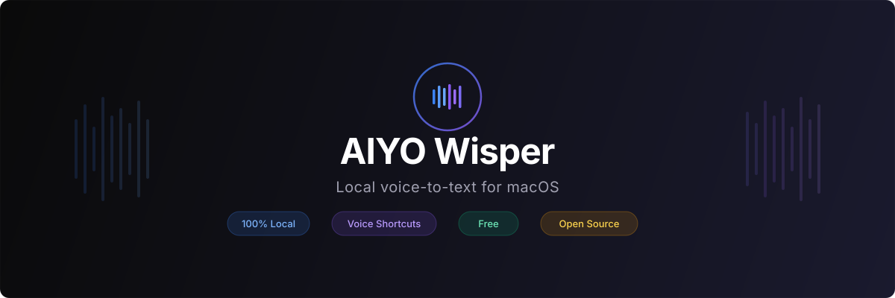

<p align="center">
  
</p>

Hold a key, speak, text appears at your cursor. No cloud. No subscription. Everything runs on your Mac.

[](LICENSE)

[**Download DMG**](https://github.com/Aiyo28/aiyo-wisper/releases/latest) · [Build from Source](#build-from-source)

---

## What it does

**Dictation** — Hold Control, speak, release. Text appears wherever your cursor is. In any app. Speech recognition runs on-device with Apple's built-in `SpeechAnalyzer`. macOS manages the language model and fetches it once on first use. Each transcription pass is pinned to a single language so it never mixes languages mid-sentence; turn off auto-detect in Settings to pin your preferred language.

**Smart Formatting** — Your dictation is cleaned up by Apple's on-device Foundation model: real punctuation, capitalization, and removal of filler words and false starts. It runs entirely on your Mac, and falls back to instant rule-based formatting whenever the model is off or unavailable.

**Voice Shortcuts** — Create trigger phrases that expand during dictation. Say "my email" and it types your full email address.

**Bring-your-own engine** — Prefer WhisperKit's CoreML models? Switch the speech engine in Settings → Transcription and download any Whisper variant you like.

## Requirements

- macOS 26.0 (Tahoe) or later
- Apple Silicon (M1 or later)
- Apple Intelligence enabled (optional — only needed for AI Formatting; dictation works without it)

## Install

1. Download the latest DMG from [Releases](https://github.com/Aiyo28/aiyo-wisper/releases/latest)
2. Drag to Applications
3. Launch — grant Microphone and Accessibility permissions
4. Start dictating. The built-in Apple engine needs no app-managed model download; macOS fetches the language model for you on first use.

## Speech engines

By default AIYO Wisper uses Apple's built-in on-device speech recognition — no app-managed download, lowest latency. If you'd rather run WhisperKit, switch engines in Settings → Transcription and pick a model:

| WhisperKit model | Size | Best for |
|-------|------|----------|
| **Turbo** | 632 MB | Highest accuracy. All languages. |
| Small | 216 MB | Balanced multilingual option. |
| English Turbo | 600 MB | Fastest for English. **Will not transcribe other languages.** |
| Lightweight | 77 MB | Smallest download. Quick notes. All languages. |

## Privacy

**No audio or text ever leaves your device.** Speech recognition (Apple `SpeechAnalyzer` or WhisperKit) and AI formatting (Apple Foundation Models) all run entirely on your Mac. No cloud APIs, no telemetry, no accounts. The only network traffic is fetching language and WhisperKit models, and update checks (manual by default; you can enable automatic checks in Settings).

## Build from Source

```bash
brew install xcodegen
git clone https://github.com/Aiyo28/aiyo-wisper.git
cd aiyo-wisper
xcodegen generate
open AiyoWisper.xcodeproj
# Cmd+R to build and run
```

## Tech Stack

| Component | Technology |
|-----------|-----------|
| Language | Swift 6 |
| UI | SwiftUI + Liquid Glass |
| Speech-to-text | Apple `SpeechAnalyzer` (default) · [WhisperKit](https://github.com/argmaxinc/WhisperKit) (optional) |
| Text formatting | Apple Foundation Models (on-device LLM) with rule-based fallback |
| Text injection | CGEvent keyboard simulation |
| Auto-update | [Sparkle](https://sparkle-project.org/) |

## License

MIT — see [LICENSE](LICENSE).
